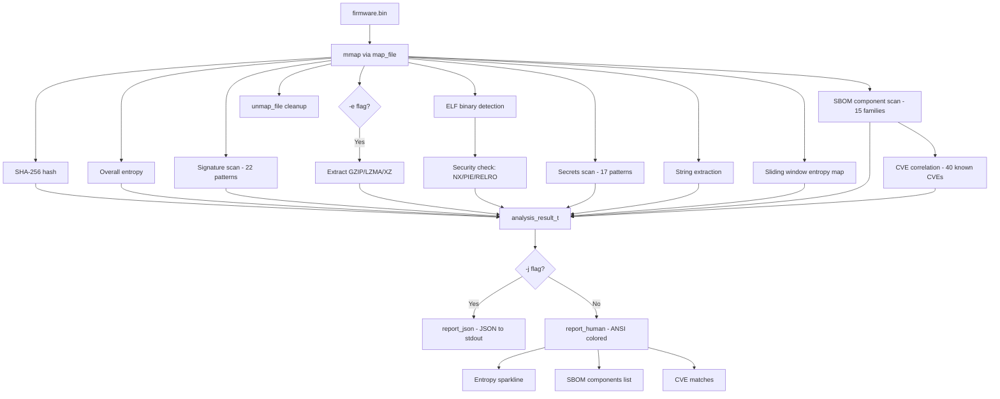
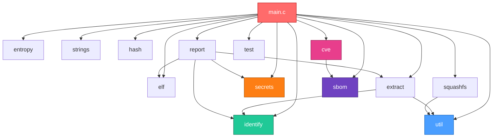

# Automata — System Architecture (v0.2.0)

## System Overview

**automata v0.2.0** is a high-performance firmware analysis engine written in C17. It is designed to inspect raw firmware binaries, flash dumps, and embedded file systems at native execution speeds with zero-copy memory mapping, strict bounds verification, and comprehensive extraction and vulnerability correlation capabilities.

The project is structured around a three-layer architecture:

1. **Engine (C core)** — Fully implemented. Comprises 14 source files and 13 public headers written in strict C17 with optional x86_64 assembly acceleration.
2. **ML (Python scikit-learn)** — Scaffold only. Prepared for supervised machine learning classification, anomaly detection, and firmware entropy modeling.
3. **Platform (FastAPI + Celery + PostgreSQL + Redis + Docker)** — Scaffold only. Designed for distributed asynchronous analysis tasks, database storage, and REST API exposure.

The CMake build system produces two primary engine artifacts:
- `automata` — Single unified CLI executable featuring modular subcommands (`scan`, `test`, `extract`, `info`, `version`, `help`).
- `libautomata.so` — Shared library packaging all analysis modules for embedding in C/C++ host applications or Python/CFFI bindings.

---

## Project Structure

```
automata/
├── CMakeLists.txt                    # Root CMake build configuration
├── LICENSE                           # MIT License
├── VERSION                           # 0.1.0 (note: code reports 0.2.0)
├── README.md                         # Project documentation and quickstart
├── engine/
│   ├── CMakeLists.txt                # Engine build configuration (automata, libautomata.so, CTest)
│   ├── include/automata/             # 13 public headers
│   │   ├── automata.h                # Master header (v0.2.0, includes all public headers)
│   │   ├── util.h                    # Memory mapping, bounds-checked readers, path utilities
│   │   ├── entropy.h                 # Shannon entropy + sliding window entropy map
│   │   ├── elf.h                     # ELF parser (32/64-bit, NX/PIE/RELRO audit)
│   │   ├── strings.h                 # ASCII printable string extraction
│   │   ├── identify.h                # Signature scanning (22 builtin patterns)
│   │   ├── extract.h                 # GZIP and LZMA/XZ stream extraction
│   │   ├── secrets.h                 # Secret and credential detection (17 patterns)
│   │   ├── hash.h                    # FNV-1a fast hash + FIPS 180-4 SHA-256
│   │   ├── report.h                  # Structured JSON and ANSI human-readable reporting
│   │   ├── squashfs.h                # SquashFS superblock parser and unsquashfs extractor
│   │   ├── sbom.h                    # Software Bill of Materials (15 component families)
│   │   └── cve.h                     # Vulnerability correlation (40 known IoT CVEs)
│   ├── src/                          # 14 implementation files
│   │   ├── main.c                    # CLI entry point + subcommand dispatcher
│   │   ├── util.c                    # mmap/munmap, safe integer readers, safe_strncpy, mkdirp
│   │   ├── entropy.c                 # Shannon entropy, sliding window map, byte histogram
│   │   ├── elf.c                     # ELF 32/64-bit header, program header, and symbol parser
│   │   ├── strings.c                 # Printable string scanner
│   │   ├── identify.c                # 22-signature pattern matching engine
│   │   ├── extract.c                 # GZIP (zlib) + LZMA/XZ (liblzma) decompressors
│   │   ├── secrets.c                 # 17-pattern table-driven credential scanner
│   │   ├── hash.c                    # FNV-1a hash + SHA-256 implementation
│   │   ├── report.c                  # JSON generation + ANSI colored terminal output
│   │   ├── squashfs.c                # SquashFS extraction via unsquashfs subprocess
│   │   ├── sbom.c                    # Component version string extraction & deduplication
│   │   ├── cve.c                     # CVE database matcher with semantic version comparison
│   │   └── test.c                    # 11 built-in unit tests (replaces test_engine binary)
│   ├── asm/
│   │   └── entropy_x86_64.S          # x86_64 assembly acceleration for byte counting
│   └── data/
├── ml/                               # ML pipeline scaffold (scikit-learn)
├── platform/                         # Web platform scaffold (FastAPI, Celery, Docker)
├── scripts/
│   └── bootstrap.sh                  # Dependency installation script (Arch/Debian)
└── docs/                             # Project documentation
    ├── architecture.md               # System architecture and memory model
    ├── modules.md                    # Detailed API documentation for all 13 modules
    ├── contributing.md               # Developer setup, coding standards, and guide
    ├── CHANGELOG.md                  # Release change tracking
    └── USAGE.md                      # CLI usage, scan pipeline, and testing guide
```

---

## Engine Analysis Pipeline (v0.2.0)

When running `automata scan <firmware.bin>`, `main.c` executes the analysis pipeline in `cmd_scan()`. The analysis is entirely zero-copy up to extraction and visualization formatting.



### Pipeline Execution Order

1. **Memory Mapping (`util.h`)**:
   `map_file()` establishes a read-only memory map (`PROT_READ`, `MAP_PRIVATE`) of the target firmware into `mapped_file_t`. The file descriptor and total size are retained.
2. **Cryptographic Hashing (`hash.h`)**:
   `sha256_hash()` computes the FIPS 180-4 SHA-256 checksum over the raw bytes, outputting a 64-character lowercase hex digest.
3. **Global Shannon Entropy (`entropy.h`)**:
   `entropy_calculate()` computes the overall entropy value across the entire file ($0.0 \le H \le 8.0$).
4. **Signature Scanning (`identify.h`)**:
   `identify_scan()` searches the buffer against `builtin_signatures[]` (22 patterns). Short or collision-prone magics (gzip, MZ, JFFS2, LZMA, SquashFS, ELF, ...) also run a header validator (for example SquashFS superblock fields, JFFS2 node CRC, ELF header fields) and are dropped or down-weighted if the header is not genuine. Remaining signatures fall back to length-based confidence (1.0 for $\ge 4$ bytes, 0.7 for 3 bytes, 0.5 for 2 bytes). Findings below `IDENTIFY_MIN_CONFIDENCE` (0.5) are hidden in the default report and ignored by extraction.
5. **Compressed Region Extraction (`extract.h`)**:
   If `-e` is passed, `extract_all()` parses detected compression offsets (GZIP via zlib, LZMA/XZ via liblzma, SquashFS v4 via `unsquashfs`) and unpacks streams into the output directory (`<file>.extracted/`).
6. **ELF Binary Security Audit (`elf.h`)**:
   The engine locates `0x7fELF` magic signatures and invokes `elf_parse_buf()` on each offset. It assesses machine architecture, endianness, class (32/64-bit), and security features: Non-Executable Stack (`NX`), Position-Independent Executable (`PIE`), Read-Only Relocations (`RELRO`), Immediate Binding (`BIND_NOW`), and stripped symbol status.
7. **Secret & Credential Detection (`secrets.h`)**:
   `secrets_scan()` executes a table-driven scan of 17 credential patterns (private keys, certificates, SSH keys, AWS access keys, passwords, bearer tokens, root shadow hashes). It extracts 64 bytes of surrounding context (32 before, 32 after) with non-printable characters sanitized to `.`.
8. **Printable String Extraction (`strings.h`)**:
   `string_extract()` extracts ASCII printable sequences meeting the minimum threshold (default 4 characters) up to 256 bytes each.
9. **Sliding Window Entropy Map (`entropy.h`)**:
   `entropy_sliding_map()` divides the firmware into overlapping windows (default 4096-byte window, 1024-byte step) to measure regional entropy variations.
10. **SBOM Component Detection (`sbom.h`)**:
    `sbom_scan()` searches for 15 known open-source and IoT component families (OpenSSL, BusyBox, Dropbear, Linux kernel, lighttpd, dnsmasq, iptables, uClibc, musl, mini_httpd, OpenSSH, curl, nginx) and extracts version numbers.
11. **CVE Vulnerability Correlation (`cve.h`)**:
    `cve_check()` evaluates all detected components against an embedded database of 40 known IoT CVEs using semantic version comparison (`version_compare()`).
12. **Report Generation (`report.h`)**:
    Outputs either machine-readable JSON (`-j`) or ANSI-colored human-readable text. In human mode, sliding entropy is visualized directly in the terminal as a Unicode block sparkline (` ▂▃▄▅▆▇█`).
13. **Resource Cleanup (`util.h`)**:
    `unmap_file()` unmaps the virtual memory region and closes the file descriptor. Dynamically allocated sliding window arrays are freed via `entropy_map_free()`.

---

## Module Dependency Graph

The engine's modules maintain strict layer separation. `util` acts as the foundational low-level dependency. All modules expose concise public C APIs in `engine/include/automata/`.



### Module Responsibilities

- **`main.c`**: Dispatches subcommands (`scan`, `test`, `extract`, `info`, `version`, `help`), orchestrates the scan pipeline, and formats terminal sparklines and supplemental reports.
- **`util`**: Memory mapping (`map_file`, `unmap_file`), endian-safe bounds-checked integer readers (`read_u16/32/64`), string copying (`safe_strncpy`), and filesystem helpers (`mkdirp`).
- **`entropy`**: Shannon entropy calculation, byte frequency histogram generation, and sliding window entropy map generation.
- **`elf`**: ELF32/ELF64 header inspection, program header analysis for NX/RELRO/PIE flags, and symbol table stripping detection.
- **`strings`**: Printable ASCII string extraction with offset tracking.
- **`identify`**: Byte-level pattern matching across 22 file/filesystem signatures.
- **`extract`**: Decompression wrapper for GZIP (zlib) and LZMA/XZ (liblzma). Depends on `identify` to discover stream offsets and `util` for directory creation.
- **`secrets`**: Pattern-based regex-free secret scanner supporting case-insensitivity, alphanumeric verification, and context window sanitization.
- **`hash`**: FNV-1a fast 32-bit hash, byte difference counter, and FIPS 180-4 SHA-256 calculation.
- **`report`**: Formatting engine for JSON output and ANSI color terminal reporting.
- **`squashfs`**: Superblock validation, filesystem sizing, and subprocess invocation of `unsquashfs`. Depends on `util` for bounds reading and directory creation.
- **`sbom`**: Component signature scanner and version string parser covering 15 component families.
- **`cve`**: CVE matcher comparing detected SBOM components with 40 embedded vulnerability definitions using version boundary comparison. Depends on `sbom.h`.
- **`test`**: 11 unit tests verifying correct functionality across entropy, strings, signatures, secrets, bounds checking, hashing, SBOM, and CVE correlation.

---

## Memory Model

Automata is designed for deterministic performance and memory safety when analyzing large firmware images:

1. **Zero-Copy Input**:
   - The input firmware file is mapped directly into the process virtual address space using `mmap()` via `map_file()`.
   - The resulting `mapped_file_t` exposes a `const uint8_t *data` pointer and `size_t size`.
   - No buffer copying occurs when scanning signatures, calculating entropy, extracting strings, parsing ELF headers, or identifying secrets.

2. **Stack-Allocated Result Buffers in `cmd_scan()`**:
   Hot analysis paths avoid dynamic heap allocation. Maximum finding limits are pre-allocated on the stack frame of `cmd_scan()`:
   - `finding_t findings[4096]` (signature matches)
   - `secret_finding_t secrets[1024]` (detected credentials)
   - `elf_info_t elfs[256]` (ELF binary metadata)
   - `extract_result_t extractions[256]` (decompression records)
   - `component_t components[256]` (SBOM discovered components)
   - `cve_entry_t cves[256]` (correlated CVE entries)
   - `extracted_string_t str_buf[128]` (printable strings batch)

3. **Heap Allocation Bounds**:
   Heap allocation is strictly isolated:
   - `entropy_map_t`: Allocates a contiguous `double *values` array sized to `(size - window_size) / step_size + 1` elements via `malloc()`. Cleaned up via `entropy_map_free()`.
   - `extract.c`: Allocates temporary decompression buffers and writes unpacked files to disk.
   - `squashfs.c`: Allocates small temporary buffers during file copy to `/tmp/automata_sqfs_XXXXXX`.

4. **Result Aggregation**:
   The `analysis_result_t` structure aggregates pointers to these pre-allocated stack arrays, ensuring that report generation remains efficient and zero-copy.

---

## Build System

The build system is powered by standard CMake (minimum version 3.16) and supports fast incremental compilation, unit testing, and installation.

### CMake Configuration

- **Root `CMakeLists.txt`**: Configures the project metadata (`VERSION 0.1.0`), C17 language standard, and invokes `add_subdirectory(engine)`.
- **`engine/CMakeLists.txt`**:
  - **`automata_lib` (SHARED)**: Compiles all 14 engine C sources plus assembly into `libautomata.so`. Linked against `-lm`, `-lz`, and `-llzma`.
  - **`automata` (EXECUTABLE)**: Compiles the 14 engine C sources and `src/main.c` into the standalone `automata` CLI binary.
  - **CTest Integration**: Registers `add_test(NAME engine_tests COMMAND automata test)` so tests can be run via `ctest`.
  - **Auto-Install Option**: `-DAUTOMATA_AUTO_INSTALL=ON` automatically triggers installation after every build.

### Compilation Flags & Optimization

- `-Wall -Wextra`: Strict compiler warning enforcement.
- `-O2`: High-performance compiler optimization.
- `-fstack-protector-strong`: Stack canary protection against buffer overflows.
- `-fPIC`: Position-independent code generation for shared library targets.
- `-D_FORTIFY_SOURCE=2`: Compile-time and run-time buffer size verification.

### Architecture-Specific Assembly

On x86_64 hosts (`CMAKE_SYSTEM_PROCESSOR MATCHES "x86_64|amd64|AMD64"`), `engine/asm/entropy_x86_64.S` is compiled and linked, defining `HAVE_ASM`. This provides vector-accelerated byte histogram counting.

### Installation

`cmake --install build` installs the executable to `${CMAKE_INSTALL_BINDIR}` (defaults to `~/.local/bin/automata` when user prefix is active, or `/usr/local/bin`).

---

## Security Design

Firmware images are inherently untrusted binary data that may be maliciously crafted to exploit analysis tooling. Automata implements defensive programming at every stage:

1. **Bounds-Checked Binary Readers**:
   Every multi-byte read is guarded by `read_u16_le/be`, `read_u32_le/be`, and `read_u64_le/be`. If `offset + sizeof(T) > size`, the read immediately aborts and returns `0` without triggering a segmentation fault or out-of-bounds memory read.
2. **Decompression Bomb Protection**:
   `extract.c` enforces a strict decompression threshold of 256 MB (`256 * 1024 * 1024` bytes). Any compressed stream (GZIP, LZMA, XZ) attempting to decompress beyond this limit is halted immediately.
3. **API Pointer Validation**:
   All public API functions validate incoming pointers (`if (!data || !out) return -1;`) before performing operations.
4. **Hardened Compiler Flags**:
   Compiled with `-fstack-protector-strong` and `-D_FORTIFY_SOURCE=2` to protect the analysis engine itself against memory corruption attacks.
5. **Sanitized Output Context**:
   When secrets or strings are displayed, non-printable characters (`< 0x20` or `> 0x7E`) and line breaks are replaced with `.` to prevent ANSI terminal escape injection and control code exploitation.
