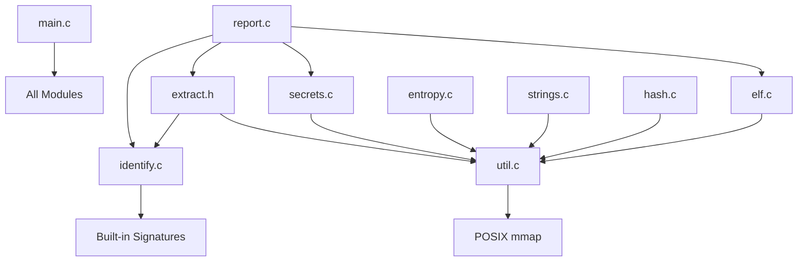
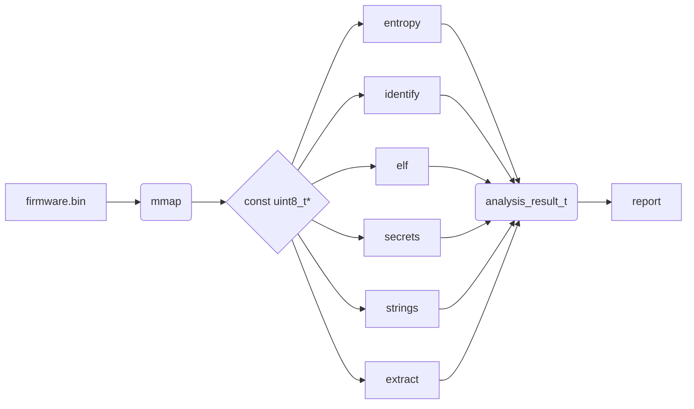

# Automata Architecture

## System Overview
The `automata` firmware analysis engine is a C17-based tool designed for rapid, static analysis of firmware images.

The CMake build system produces three main artifacts:
- `automata`: The standalone CLI binary.
- `libautomata.so`: A shared library for integration.
- `test_engine`: The test suite executable.

The complete architecture consists of three layers:
- **Engine**: The core analysis logic written in C17. (Currently the only implemented layer).
- **ML**: Machine learning analysis (Python/scikit-learn). (Stub)
- **Platform**: Web and task distribution layer (FastAPI + Celery + PostgreSQL + Redis). (Stub)

## Engine Architecture
The core engine operates through a streamlined pipeline pattern within `main.c`. The steps are:

1. **Parse CLI args**: Handled manually (no `getopt` dependency).
2. **Memory Map File**: Call `map_file()` to produce a `mapped_file_t {data, size, fd}`.
3. **Hashing**: Compute SHA-256 via `sha256_hash()`.
4. **Entropy**: Calculate overall Shannon entropy via `entropy_calculate()`.
5. **Signature Scan**: Execute `identify_scan()` against the `builtin_signatures[]`.
6. **Extraction**: If the `-e` flag is provided, extract compressed regions (zlib/liblzma) using `extract_all()`.
7. **ELF Parsing**: Walk data looking for `0x7fELF` magic and parse each with `elf_parse_buf()`.
8. **Secrets Scan**: Search for embedded secrets via `secrets_scan()`.
9. **String Extraction**: Extract printable strings using `string_extract()`.
10. **Generate Report**: Output findings via `report_json()` or `report_human()`.
11. **Cleanup**: Unmap the memory using `unmap_file()`.

## Module Dependency Graph

*Note: All modules include their own header. `util.c` serves as the foundational layer providing memory mapping and bounds-checked readers. `identify.c` is standalone.*

## Memory Model
- **Zero-copy Mapping**: The input file is mapped into memory using `mmap`.
- **Const Pointers**: All analysis operates on a `const uint8_t*` pointer to the memory-mapped region.
- **Stack Allocation**: Results are stored in stack-allocated arrays within `main()` (e.g., `findings[4096]`, `secrets[1024]`).
- **Aggregation**: The `analysis_result_t` structure aggregates pointers to these stack arrays.
- **No Hot Path Heap Allocation**: The core analysis avoids heap allocation entirely, with the exception of `extract.c` which requires it for file I/O operations.

## Build System
The build is orchestrated by CMake.
- The root `CMakeLists.txt` delegates to `add_subdirectory(engine)`.
- `engine/CMakeLists.txt` defines three targets:
  - `automata_lib` (SHARED): Compiles all `src/*.c` and links with `-lm -lz -llzma`.
  - `automata` (EXECUTABLE): Compiles all `src/*.c` plus `src/main.c` and links to the library.
  - `test_engine` (EXECUTABLE): Compiles `tests/test_engine.c` plus all `src/*.c`.
- **x86_64 ASM**: Assembly optimizations like `asm/entropy_x86_64.S` are guarded by a `CMAKE_SYSTEM_PROCESSOR` check.
- **Include Directories**: `engine/include` and `engine/data`.

## Security Considerations
- **Bounds Checking**: All pointer reads are strictly bounds-checked using functions like `read_u16_le()`.
- **Zip Bomb Protection**: Maximum decompression size is capped at 256MB.
- **Null Safety**: NULL pointer checks exist on all public API entry points.
- **Compilation Hardening**: Uses flags `-fstack-protector-strong` and `-D_FORTIFY_SOURCE=2`.

## Data Flow Diagram

